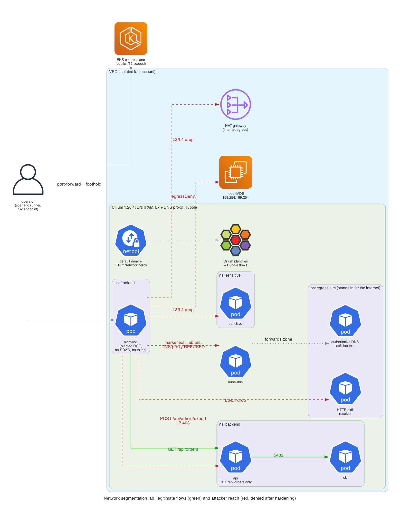

# Kubernetes Network Segmentation Lab

Assume a workload is already compromised. How far can it talk, and how much
does identity-based network segmentation shrink that reach? This lab answers
with a before/after connectivity matrix, backed by Hubble flow evidence, where
the only thing that changes between the two runs is network policy.

It is a deliberate sibling to [eks-attack-range](https://github.com/jordann6/eks-attack-range),
and the two do not overlap. Attack Range is about *gaining* privilege: a
scripted kill chain from one HTTP request to cluster-admin. This lab hands the
attacker a working foothold on purpose and measures one control only: network
separation and egress control.

## Problem

"We have network policies" usually means a default-deny somewhere and no proof
of what it stops. Three things make that claim hard to trust:

- Nobody measures the *before*. A denied connection proves nothing if it was
  never possible in the first place.
- Denials are inferred from timeouts. A timeout looks the same whether policy
  dropped the packet, the destination was down, or DNS failed.
- Egress through DNS gets missed. An FQDN allowlist controls where a pod can
  connect, not what it can put in a DNS question, and a query for
  `<data>.attacker.example` delivers the data even when the answer is NXDOMAIN.

## Architecture



*The frontend pod carries a planted RCE (the assumed foothold) with no RBAC and
no ServiceAccount token. Green edges are the two legitimate flows that must keep
working: frontend to `GET /api/orders` on the backend API, and API to the
database. Red edges are what the attacker tries from the foothold: the
sensitive service, a controlled HTTP exfil receiver, a DNS-channel marker to a
controlled authoritative server, a forbidden `POST` on the same backend port,
the node's metadata service, and the public internet. Every red edge is open in
the baseline and denied after hardening, each by the layer named on the edge.*

## The result

From the live run, `evidence/eks-reference/report.md` (EKS 1.34, Cilium 1.20.4
with AWS ENI IPAM, two nodes, deployed, measured and destroyed in one sitting):

| Test | Baseline | Hardened | After reschedule | Enforcement evidence (hardened) |
| ---- | -------- | -------- | ---------------- | ------------------------------- |
| Frontend to permitted backend route | Allowed | Allowed | Allowed | still passes (HTTP 200) |
| Backend to database | Allowed | Allowed | Allowed | still passes |
| Frontend to sensitive service | Allowed | Denied | Denied | Hubble `DROPPED POLICY_DENIED`, identity 48469 to 1527, port 8080 |
| Frontend to controlled exfil receiver | Received | Denied | Denied | Hubble `DROPPED POLICY_DENIED`, marker never reached the receiver |
| Synthetic DNS marker to authoritative receiver | Received | Denied | Denied | client sees `REFUSED`; Hubble DNS-proxy drop; direct query to the receiver also dropped |
| Frontend to forbidden backend HTTP operation | Allowed | Denied | Denied | client sees HTTP `403`; Hubble L7 `DROPPED POST /api/admin/export` |

Two supplemental probes, both measured live:

| Probe | Baseline | Hardened | Evidence |
| ----- | -------- | -------- | -------- |
| Pod reaches node instance metadata (`169.254.169.254`) | Allowed | Denied | Hubble `DROPPED POLICY_DENY`: the explicit `egressDeny`, not just default deny |
| Pod reaches the public internet | Allowed | Denied | Hubble policy drop to the `world` identity |

The metadata probe is a reachability check (the IMDSv2 token endpoint answers),
the precondition for T1552.005. It never requests a credential path and the
token is discarded unprinted. Network access is not credential theft.

The attacker still executes commands after hardening. The RCE answers in all
three columns; what changed is what those commands can reach.

**Reschedule receipt.** After the hardened run, the frontend, API and database
pods are replaced and each one moves to the other node. On EKS every pod got a
new VPC address from a different ENI, kept the same Cilium security identity
(frontend `48469`, api `10369`, db `6721`), and every row produced the same
result, including the two legitimate flows, which cross nodes in both
placements. That is the point of identity-based policy over IP-based rules.

**Same result locally.** The identical matrix passes on kind
(`evidence/kind-reference/`), where the metadata probe reports `skipped`
because kind has no metadata service. The runner refuses to claim a defense
it could not first show was needed.

## Decisions

- **Change only policy between runs.** Same cluster, CNI, image, foothold,
  RBAC, metadata settings and security groups. The baseline is an explicit
  allow-all `CiliumNetworkPolicy`, so the engine is provably enforcing in both
  runs. No firewall layer is added, because it would also deny the egress rows
  and muddy the attribution. See [ADR-0002](docs/adr/0002-change-only-policy.md).
- **Cilium as the only CNI, ENI IPAM on EKS, no VPC CNI chaining.** L7 and DNS
  policy are two of the six rows, and Cilium documents L7 limitations under
  chaining. A readiness gate refuses to deploy or measure until every pod is
  managed by Cilium. See [ADR-0001](docs/adr/0001-cilium-eni-no-chaining.md).
- **An honest comparison.** The VPC CNI has enforced `NetworkPolicy` since
  August 2023 and logs policy decisions. This lab claims only Cilium's L7 HTTP
  rules, DNS-aware egress, identity that survives rescheduling, and the Hubble
  workflow. Default deny is written as plain `NetworkPolicy` to make clear that
  part is not Cilium-specific. See [ADR-0003](docs/adr/0003-honest-comparison.md).
- **DNS is two controls.** Destination filtering (port 53 only to kube-dns) and
  query-name filtering (the DNS proxy refuses every name but one) are separate
  rules and tested separately. See [ADR-0004](docs/adr/0004-dns-two-controls.md).
- **The runner cannot print a false "defended".** A hardened row is only
  `blocked` if the same run's baseline was `exploitable`, the destination passed
  a health check from inside itself, and the denial carries evidence from the
  layer that enforced it: a policy drop for L3/L4, an HTTP 403 plus an L7 drop
  for HTTP, `REFUSED` plus a DNS-proxy drop for DNS. A timeout without that
  evidence is `error`. Exfil is judged at the receiver, not by the client's exit
  code. These rules are unit tested (`make test`).

## What broke while building it

- **Strict DNS allowlists broke the legitimate app first.** With the default
  `ndots:5`, the pod's resolver asked for
  `api.backend.svc.cluster.local.frontend.svc.cluster.local` before the real
  name. The DNS proxy correctly refused it, and musl stops at the first
  `REFUSED` instead of trying the next search domain, so the permitted
  `GET /api/orders` failed with "could not resolve host". The fix was
  `ndots:2` in every pod's `dnsConfig` (identical in both runs), not widening
  the allowlist.
- **Kubernetes injected an env var that crashed the API.** A Service named `db`
  makes Kubernetes inject `DB_PORT=tcp://10.96.x.x:5432` into every pod in the
  namespace, which collided with the app's own `DB_PORT` and crash-looped it on
  `int()`. Fixed with `enableServiceLinks: false` and `LAB_`-prefixed variables.
- **The first hardened sensitive-service probe proved the wrong thing.** It
  failed at DNS (the name was not on the allowlist), so it was a resolver
  refusal, not a network-layer denial. The runner now also probes by ClusterIP,
  as an attacker who already knows the address would, and the evidence is the
  Hubble L3/L4 policy drop.
- **The first reschedule receipt proved nothing, and the runner caught it.** A
  plain rollout restart on kind gave the new frontend pod the exact IP its
  predecessor had just released on the same node, so "same result with a new
  IP" was not true, and the run reported FAIL. A second attempt read the old
  pods, because a terminating pod still reports phase `Running`. The reschedule
  now moves every workload to the other node (a different pod CIDR, so the IP
  must change), waits for the old pods to be deleted, and skips pods with a
  deletion timestamp. The run fails unless both IP and node changed.
- **On EKS, the node security group silently ate a scenario, and the runner
  refused to call it a defense.** The first live run reported FAIL: the
  baseline DNS marker never reached the receiver, so the hardened DNS row was
  marked `skipped`, not `Denied`. Hubble showed CoreDNS's forwarded query
  leaving node a and never arriving on node b. Under Cilium ENI IPAM, pod
  addresses sit on ENIs that carry the *node* security group, and the EKS
  module's recommended rules only open node-to-node TCP 1025-65535 and port 53.
  The receiver listens on UDP 5353, so the VPC dropped it before Cilium ever
  saw it. The fix is a self-referencing all-traffic rule on the node security
  group, identical in both runs, so pod-to-pod filtering is left to the policy
  under test. The failed run is kept in `evidence/eks-run1-fail/` as the
  receipt. A naive harness would have shown that row as "Denied" in both
  columns.
- **A naive drop matcher would have over-claimed.** The first evidence matcher
  accepted any `DROPPED` L3/L4 flow. It now requires a policy drop reason
  (`POLICY_DENIED` or `POLICY_DENY`), because a drop for any other reason is not
  evidence that segmentation did the work.

## Run it

Local, zero cloud spend:

```bash
make kind-up        # kind (no default CNI) + pinned Cilium 1.20.4 + Hubble, readiness-gated
make app            # four namespaces, receivers, CoreDNS stub zone for exfil.lab.test
make demo           # baseline -> hardened -> reschedule, report in evidence/<run-id>/
make test           # unit tests for the runner's honesty rules
make kind-down
```

Live EKS (one bounded session, operator runs the apply and destroy from saved
plans): see [docs/runbook-aws.md](docs/runbook-aws.md).

## Repository layout

| Path | What it is |
|------|------------|
| `infra/` | VPC, EKS (two single-node groups), ECR, Cilium ENI IAM, node SG self rule. Local state, isolated account |
| `cilium/` | Pinned Helm values (common, kind, EKS) and the readiness gate |
| `kind/` | Local cluster config, default CNI disabled |
| `app/` | One stdlib-only image for every role, plus the Kubernetes manifests |
| `policy/baseline/` | Explicit allow-all `CiliumNetworkPolicy` per namespace |
| `policy/hardened/` | Default deny, identity L3/L4, DNS proxy rule, L7 HTTP rule, metadata deny |
| `scenarios/` | The runner and its unit tests |
| `evidence/` | Live EKS and kind reference reports, the failed first EKS run, gzipped Hubble flows |
| `docs/` | ADRs, runbook, diagram source |

Frameworks referenced: NSA/CISA Kubernetes Hardening Guidance (network
separation), MITRE ATT&CK for Containers (Lateral Movement TA0008, Exfiltration
TA0010, and T1552.005 as a reachability precondition only).

## Production scale

In a real estate this policy set is a platform default, not per-app work:
default-deny ingress and egress stamped into every namespace by the namespace
template, DNS and L7 allowlists owned by the service team in the same repo as
the service, and Hubble flows shipped to the SIEM so a new `POLICY_DENIED` from
a production identity pages someone. Network policy is one layer, not the
whole answer. Production adds what this lab deliberately leaves out to keep the
measurement clean: IMDS hop limit 1 on every node, an egress firewall at the
VPC edge (AWS Network Firewall or Route 53 Resolver DNS Firewall) so egress
filtering does not depend on every namespace getting its policy right, and
Security Groups for Pods where a workload needs an AWS-level boundary. And the
matrix runner becomes a CI check: re-run it against every cluster after each
policy change, and fail the pipeline if any row regresses.
